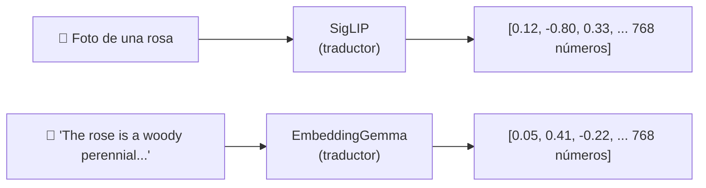
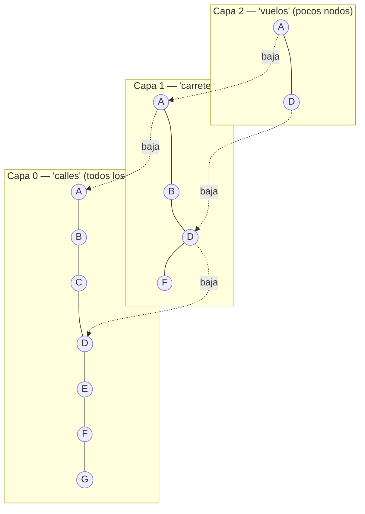
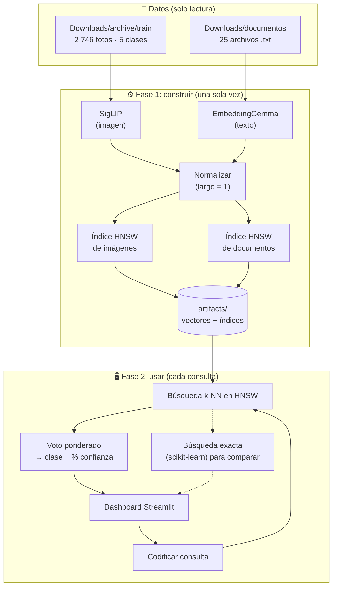
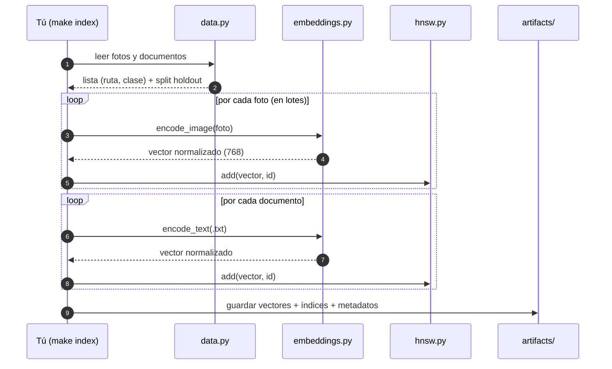
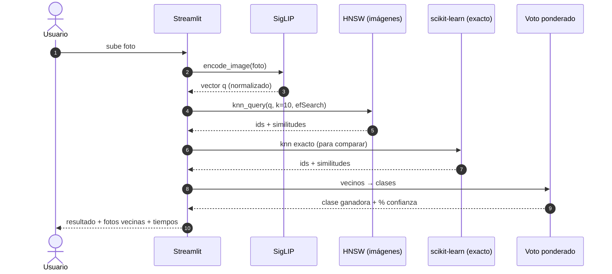
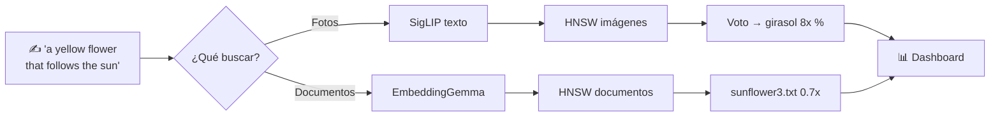
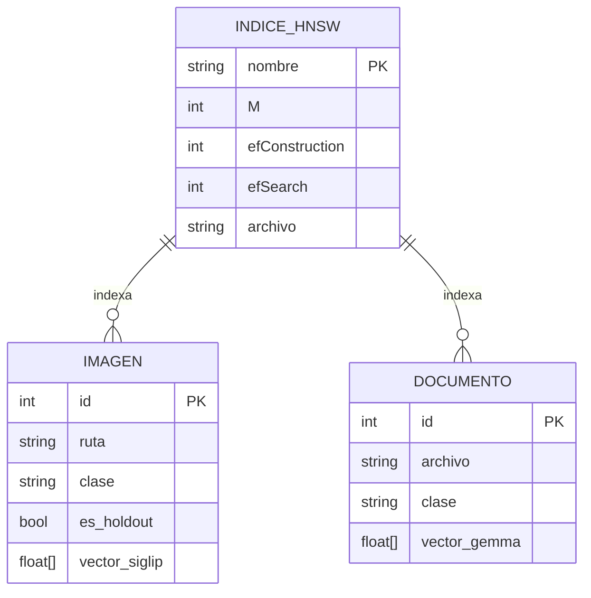
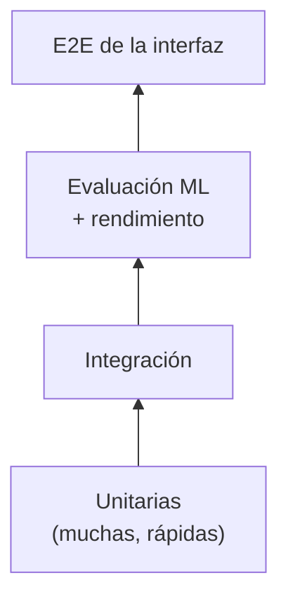

# PRD — Buscador local de flores con HNSW

> **Estado:** borrador vivo. Las secciones marcadas con 🔧 se completan con números reales cuando el sistema esté construido.
> **Repositorio:** `search-engine-hnsw` · **Todo corre en tu computador, sin internet** (después de bajar los modelos una vez).

---

## 1. ¿Qué vamos a construir? (en una frase)

Un **buscador** donde escribes una pregunta (*"a yellow flower that follows the sun"*) o subes la **foto de una flor**, y el programa te dice **qué flor es** (margarita, diente de león, rosa, girasol o tulipán) y **qué tan seguro está**, mostrándote las fotos y los textos más parecidos que tiene guardados.

### Por qué existe este proyecto
Google, Spotify o Netflix buscan cosas "parecidas" entre millones de elementos y responden en milisegundos. No pueden comparar tu consulta con *todo* uno por uno. Usan un truco de estructuras de datos llamado **índice vectorial**. Este proyecto construye uno pequeño, completo y entendible, para aprender cómo funciona por dentro.

### Qué NO es
- No usa la nube ni APIs de pago.
- No "reconoce flores" con un modelo entrenado por nosotros: usamos modelos ya entrenados para *convertir cosas en números* y nosotros construimos la **búsqueda**.

---

## 2. ¿Cómo leer este documento?

Está escrito para alguien que **sabe programar lo básico** (variables, ciclos, listas, funciones) y está empezando **Estructuras de Datos y Algoritmos**. Cada idea nueva trae una **analogía** con algo que ya conoces:

| Idea nueva | Se parece a… (lo que ya viste) |
|---|---|
| Vector / embedding | Un **arreglo** de números, como `[0.2, -0.7, 0.1]` |
| Búsqueda por fuerza bruta | **Búsqueda lineal** O(n) |
| Índice HNSW | Una **skip list** + un **grafo** + una **búsqueda voraz** |
| k vecinos más cercanos | Un **top-k** (ordenar y quedarte con los k mejores) |
| Similitud coseno | Un **producto punto** (suma de productos) |
| Recall | Qué porcentaje de las respuestas correctas **encontraste** |

Orden sugerido: secciones 3 → 4 (teoría) → 5 (arquitectura) → 6 (la demo paso a paso). Las secciones 7 a 13 son requisitos, métricas, pruebas y plan de trabajo.

---

## 3. Glosario rápido

- **Embedding:** lista de números (por ejemplo 768) que *resume el significado* de una foto o un texto. Cosas parecidas → números parecidos.
- **Vector:** la lista de números, vista como una flecha en un espacio de muchas dimensiones.
- **Normalizar:** cambiar el vector para que su largo sea 1 (solo importa hacia dónde apunta).
- **Similitud coseno:** número entre -1 y 1 que dice qué tan parecidas son dos flechas por su dirección. 1 = misma dirección.
- **k-NN (k vecinos más cercanos):** "dame los k elementos más parecidos a mi consulta".
- **ANN (vecino más cercano aproximado):** k-NN que acepta equivocarse un poquito a cambio de ser **muchísimo** más rápido.
- **HNSW:** *Hierarchical Navigable Small World*. Es el algoritmo de índice ANN que usaremos.
- **Recall@k:** de los k vecinos *verdaderos*, ¿cuántos encontró el índice? 95 % = encontró 19 de 20.
- **Holdout:** ~15 % de las fotos que **no se meten al índice** y se usan para examinar el sistema.

---

## 4. Teoría paso a paso

### 4.1 De una foto a números: los embeddings

Un computador no "ve" una foto ni "entiende" una frase. Para él son números. Un **modelo de embeddings** es como un **traductor** que recibe una foto o un texto y devuelve una lista de números fija (p. ej. 768 números) donde:

- Dos fotos de **rosas** dan listas **parecidas**.
- Una foto de rosa y una de girasol dan listas **distintas**.

Usamos dos traductores, ambos de Google y ambos corren local:

| Modelo | Qué traduce | Para qué lo usamos |
|---|---|---|
| **SigLIP** | Fotos **y** frases, al **mismo** espacio | Buscar foto→foto y texto→foto |
| **EmbeddingGemma** | Texto (basado en Gemma) | Buscar pregunta→documento `.txt` |

> **Importante:** las listas de modelos distintos **no se pueden comparar entre sí** (como comparar metros con grados). Por eso hay **dos índices separados**: el de imágenes (SigLIP) y el de documentos (EmbeddingGemma).



### 4.2 Medir "qué tan parecidos" son dos vectores

**Idea:** imagina cada vector como una **flecha**. Dos flechas apuntando casi al mismo lado = cosas parecidas.

**Similitud coseno** (se calcula con lo que ya sabes):

```
coseno(a, b) = (a · b) / (|a| · |b|)

a · b = a1*b1 + a2*b2 + ... + an*bn      ← producto punto: un ciclo for con una suma
|a|   = raíz( a1² + a2² + ... + an² )     ← el "largo" de la flecha
```

Resultado: **1** = misma dirección (muy parecidos), **0** = sin relación, **-1** = opuestos.

**¿Por qué coseno y no distancia normal?** La distancia normal (euclidiana) se afecta por el *tamaño* del vector; al coseno solo le importa la *dirección*, que es donde los modelos guardan el significado.

**Truco de eficiencia:** si **normalizamos** todos los vectores (largo = 1), entonces `|a| = |b| = 1` y la fórmula se reduce a:

```
coseno(a, b) = a · b        ← solo un producto punto, ¡mucho más barato!
```

Ejemplo con 2 números (2 dimensiones):

```
a = [3, 4]  → |a| = 5  → normalizado: [0.6, 0.8]
b = [4, 3]  → |b| = 5  → normalizado: [0.8, 0.6]
coseno = 0.6*0.8 + 0.8*0.6 = 0.48 + 0.48 = 0.96   ← muy parecidos
```

### 4.3 Buscar los k más parecidos: la forma "ingenua" (fuerza bruta)

Es **búsqueda lineal**: comparas la consulta contra *todos* los vectores y te quedas con los k mejores.

```python
def buscar_exacto(consulta, vectores, k):
    puntajes = []
    for i, v in enumerate(vectores):          # recorre los n elementos
        puntajes.append((i, producto_punto(consulta, v)))
    puntajes.sort(key=lambda p: p[1], reverse=True)   # ordena
    return puntajes[:k]                        # top-k
```

- Tiempo: **O(n · d)** (n elementos, d números por vector). Con 2 746 fotos funciona bien.
- Con 100 millones de fotos se vuelve imposible de usar en tiempo real.
- Aun así lo **necesitamos**: es la **respuesta correcta de referencia** (lo hacemos con `scikit-learn`) para medir qué tan bien funciona el índice rápido.

### 4.4 La idea del índice: no mires todo

Piensa en estas estructuras que ya conoces:

| Estructura | Cómo evita recorrer todo |
|---|---|
| **Árbol binario de búsqueda** | Descartas la mitad en cada paso → O(log n) |
| **Skip list** | Niveles de "autopistas" para saltar lejos, y niveles de "calles" para afinar |
| **Grafo** | Cada nodo conoce a sus vecinos; caminas de vecino en vecino |

El problema: los vectores de muchas dimensiones **no se pueden ordenar** como números sueltos, así que un árbol binario no sirve bien. HNSW combina **skip list + grafo**.

### 4.5 HNSW explicado como un viaje en una ciudad

Imagina buscar una dirección en un país:

1. **Capa alta (pocos nodos, aristas muy largas):** como los **vuelos entre ciudades**. Saltas lejos rápido, pero con poca precisión.
2. **Capas medias:** como **carreteras** entre pueblos.
3. **Capa 0 (todos los nodos, aristas cortas):** como las **calles de tu barrio**. Aquí afinas y llegas a la puerta exacta.

**Búsqueda (voraz o *greedy*):**

1. Entras por la capa más alta, desde un nodo de entrada.
2. Miras a los vecinos del nodo actual. Si alguno está **más cerca de la consulta**, te mueves a él. Repites hasta que ninguno mejore.
3. Bajas una capa **desde donde quedaste** y repites.
4. En la capa 0 mantienes una lista de los mejores candidatos (de tamaño `efSearch`) y devuelves los k mejores.



**¿En qué capa cae cada elemento al insertarlo?** Se sortea con una probabilidad que decrece exponencialmente (igual que en una **skip list**): casi todos solo viven en la capa 0, pocos llegan a la 1, poquísimos a la 2, etc. Por eso arriba hay pocos nodos.

**Construcción (insertar un elemento nuevo):**

1. Sortea su capa máxima `L`.
2. Baja desde la capa más alta hasta `L+1` buscando un punto de entrada cercano (búsqueda voraz).
3. En cada capa de `L` hasta 0: busca los `efConstruction` candidatos más cercanos y **conéctalo con sus `M` mejores vecinos** (conexiones en ambos sentidos).
4. Si algún vecino queda con más de `M` conexiones, **recorta** las peores.

### 4.6 Los 3 botones de HNSW

| Parámetro | Qué controla | Si lo subes… |
|---|---|---|
| `M` | Cuántos vecinos guarda cada nodo | + precisión, + memoria, construir más lento |
| `efConstruction` | Qué tan "a fondo" busca al construir | + calidad del grafo, construir más lento |
| `efSearch` | Cuántos candidatos explora al consultar | + recall, consulta más lenta |

> Es el clásico compromiso **velocidad ↔ precisión**, igual que elegir entre un algoritmo exacto y una heurística.

### 4.7 ¿Cuánto cuesta? (Big-O)

| Método | Consulta | Notas |
|---|---|---|
| Fuerza bruta | **O(n · d)** | Exacto |
| HNSW | **≈ O(log n · d)** en la práctica | Aproximado; memoria extra O(n · M) |

Con n = 2 746 la ganancia es pequeña; la gráfica de crecimiento (🔧 benchmark) muestra cómo se separan las dos curvas cuando n crece.

### 4.8 De "vecinos" a "qué flor es y qué tan seguro estoy"

Cuando subes una foto:

1. La convertimos en vector (SigLIP).
2. HNSW nos da los **k vecinos** más parecidos (p. ej. k = 10) con su similitud coseno.
3. Cada vecino **vota** por su clase, con peso = su similitud:

```
puntaje[clase] = suma de similitud de los vecinos de esa clase
confianza[clase] = puntaje[clase] / suma de todos los puntajes
```

Ejemplo (k = 5): vecinos → rosa 0.91, rosa 0.89, rosa 0.85, tulipán 0.70, rosa 0.84.
`rosa = 0.91+0.89+0.85+0.84 = 3.49`, `tulipán = 0.70`, total = 4.19 → **rosa 83 %**, tulipán 17 %.

> Esto es un **k-NN ponderado**: es un clasificador sin entrenamiento; la "inteligencia" viene de los embeddings.

Para una **pregunta de texto** hay dos rutas:
- **Texto → fotos** (SigLIP entiende texto y fotos en el mismo espacio) → mismo voto de arriba.
- **Texto → documentos** (EmbeddingGemma) → muestra los `.txt` más parecidos con su % de similitud.

### 4.9 ¿Cómo sabemos si funciona? (métricas)

- **Accuracy top-1:** % de fotos del holdout cuya clase adivinó bien.
- **Recall@k del índice:** qué tanto coincide HNSW con la búsqueda exacta.
- **Matriz de confusión:** tabla que muestra *qué flores confunde con cuáles*.
- **Latencia:** milisegundos por consulta.

---

## 5. Arquitectura

### 5.1 Vista general (todo local)



### 5.2 Componentes y responsabilidades

| Módulo | Qué hace | Se parece a… |
|---|---|---|
| `config.py` | Rutas, clases, parámetros | Constantes del programa |
| `data.py` | Lee imágenes/documentos, separa train/holdout | Leer archivos y dividir una lista |
| `embeddings.py` | Carga SigLIP y EmbeddingGemma, devuelve vectores normalizados | Función `foto → arreglo` |
| `hnsw.py` | **Nuestro HNSW** hecho en NumPy | Implementar una estructura de datos |
| `index.py` | Construye, guarda y carga los índices | Serializar una estructura |
| `search.py` | k-NN, voto ponderado, confianza | Top-k + diccionario de conteos |
| `metrics.py` | Accuracy, recall@k, matriz de confusión | Contar aciertos |
| `app/streamlit_app.py` | Dashboard | La "cara" del programa |

### 5.3 Fase 1 — Construcción del índice (secuencia)



### 5.4 Fase 2 — Consulta con una foto (secuencia)



### 5.5 Fase 2 — Consulta con una pregunta de texto



### 5.6 Modelo de datos (qué se guarda en `artifacts/`)



### 5.7 Cómo correr todo en local

| Requisito | Detalle |
|---|---|
| SO | macOS (probado) |
| Python | 3.12 con `uv` (el Python 3.15 del sistema no tiene paquetes de IA aún) |
| Internet | **Solo** para bajar los modelos la primera vez |
| Hardware | Basta un portátil: ~3 700 fotos pequeñas y 25 textos |

```
make setup     # crea entorno y instala dependencias
make models    # descarga SigLIP y EmbeddingGemma (una vez)
make index     # construye los índices (vectoriza + HNSW)
make evaluate  # accuracy, recall, matriz de confusión
make bench     # fuerza bruta vs HNSW
make demo      # abre el dashboard en http://localhost:8501
make test      # corre todas las pruebas
```

---

## 6. La demo paso a paso: "qué pasa por detrás" 🔧

*(Se completa con números reales al terminar el sistema. Esqueleto del recorrido:)*

**Escenario:** subes una foto de una **rosa** del conjunto `test`.

| # | Qué pasa | Dónde | Resultado (🔧 real) |
|---|---|---|---|
| 1 | Streamlit recibe el archivo | `app/streamlit_app.py` | imagen 320×240 |
| 2 | Se redimensiona y normaliza para SigLIP | `embeddings.py` | tensor 224×224 |
| 3 | SigLIP la convierte en vector | `embeddings.py` | 768 números |
| 4 | Se normaliza el vector | `embeddings.py` | largo = 1.0 |
| 5 | Entra al HNSW por la capa más alta | `hnsw.py` | nodo de entrada |
| 6 | Baja capa por capa con búsqueda voraz | `hnsw.py` | nº de saltos |
| 7 | En capa 0 explora `efSearch` candidatos | `hnsw.py` | nº de comparaciones vs 2 334 |
| 8 | Devuelve los k vecinos con coseno | `search.py` | lista (id, similitud) |
| 9 | Voto ponderado por clase | `search.py` | rosa XX %, … |
| 10 | Dashboard muestra clase, % y vecinos | Streamlit | gráfica + miniaturas |

Para la **pregunta de texto** se repite el recorrido con el codificador de texto y se muestran los `.txt` más parecidos.

---

## 7. Requisitos

### Funcionales
1. **RF1** Subir una foto y obtener clase más probable, % de confianza por cada clase y los k vecinos con su foto.
2. **RF2** Escribir una pregunta y obtener (a) fotos y clase más cercanas y (b) documentos más cercanos con su similitud.
3. **RF3** Ver tiempo de la búsqueda HNSW vs búsqueda exacta y cuántas comparaciones hizo cada una.
4. **RF4** Ajustar `k` y `efSearch` desde el dashboard.
5. **RF5** Reconstruir los índices con un solo comando.

### No funcionales
- **RNF1** 100 % local; sin llamadas de red tras descargar modelos.
- **RNF2** Consulta (sin contar codificador) < 50 ms.
- **RNF3** Código documentado y legible: el `hnsw.py` debe poder leerse como material de clase.
- **RNF4** Reproducible: un `make` por paso.
- **RNF5** No modifica ni borra los datos originales.

---

## 8. Métricas de éxito

| Métrica | Meta | Cómo se mide |
|---|---|---|
| Accuracy top-1 (holdout) | ≥ 90 % | `scripts/evaluate.py` |
| Recall@5 de clase | ≥ 97 % | `scripts/evaluate.py` |
| Recall del HNSW vs exacto (k = 10) | ≥ 95 % | test de integración + bench |
| Latencia de consulta del índice | < 50 ms | `scripts/bench.py` |
| Speed-up HNSW vs fuerza bruta | medido y graficado | `scripts/bench.py` |
| Texto → clase correcta (consultas de demo) | 5 de 5 | test E2E |
| Demo completa | `make demo` lista en < 2 min con índice construido | ensayo manual |

---

## 9. Estrategia de pruebas



| Tipo | Qué verifica | Ejemplo |
|---|---|---|
| **Unitarias** | Funciones pequeñas | coseno de `[3,4]` y `[4,3]` normalizados = 0.96; el voto suma 100 % |
| **Propiedades** | Reglas que siempre deben cumplirse | los resultados HNSW son ids válidos y vienen ordenados; con `efSearch` enorme ≈ exacto |
| **Integración** | Piezas juntas | vectores con forma y norma 1; construir→guardar→cargar→consultar; HNSW propio vs `hnswlib` vs `scikit-learn` |
| **Evaluación ML** | Calidad de la respuesta | accuracy y matriz de confusión en holdout |
| **Rendimiento** | Velocidad | benchmark al variar n y `efSearch` |
| **E2E de UI** | Dashboard | `streamlit.testing AppTest`: escribir pregunta, subir foto |
| **Documentación** | Diagramas y números del PRD | los bloques mermaid compilan; el ejemplo del paso 6 coincide con una corrida real |

Regla de trabajo: **ninguna tarea se integra a `main` sin sus pruebas en verde**.

---

## 10. Skills y herramientas que usamos

| Para qué | Herramienta |
|---|---|
| Entorno Python reproducible | `uv` |
| Diagramas | skill `diagrams` + `mermaid-cli` para verificar que compilan |
| Documentación | skill `docs` |
| Pruebas | skill `testing`, `pytest` |
| Probar el dashboard corriendo | skill `run` |
| Revisión antes de integrar | skills `code-review` y `simplify` |
| Código limpio | skill `solid-clean-code` |
| Modelos | `huggingface-cli` (SigLIP y EmbeddingGemma; este último puede pedir aceptar su licencia una vez) |

---

## 11. Plan de trabajo y agentes

Cada mini-tarea tiene su rama, su agente, pruebas y un commit que se integra a `main`.

| # | Tarea | Agente |
|---|---|---|
| 1 | Estructura del proyecto y `make` | Cursor (Grok 4.7 high) |
| 2 | PRD parte 1 (este documento) | Claude Code |
| 3 | Lector de datos y split holdout | Cursor |
| 4 | Embeddings SigLIP + EmbeddingGemma | Codex |
| 5 | HNSW propio + comparación con `hnswlib` y `scikit-learn` | Codex |
| 6 | Construcción de índices | Codex |
| 7 | Búsqueda, voto y métricas | Cursor |
| 8 | Evaluación y benchmark | Codex → revisa Claude |
| 9 | Dashboard Streamlit + prueba de UI | Cursor |
| 10 | PRD parte 2 con números reales | Claude Code |
| 11 | Revisión final y ensayo de la demo | Claude Code |

Claude Code supervisa: lanza, revisa y, si un agente se queda atascado, lo reinicia con el contexto de lo que falta.

---

## 12. Riesgos

| Riesgo | Plan |
|---|---|
| Python del sistema demasiado nuevo para PyTorch | Usar Python 3.12 con `uv` |
| EmbeddingGemma pide aceptar licencia | Un paso manual; si no se puede, SigLIP texto como respaldo (y se documenta) |
| Solo 25 documentos | Evaluar texto con consultas de prueba por clase |
| `hnswlib` no compila | Nuestro HNSW + la búsqueda exacta bastan |
| Un agente se atasca | Supervisor lo reinicia con la tarea restante |

---

## 13. Referencias

- Malkov & Yashunin (2016), *Efficient and robust approximate nearest neighbor search using Hierarchical Navigable Small World graphs*.
- Pugh (1990), *Skip Lists: A Probabilistic Alternative to Balanced Trees*.
- Zhai et al. (2023), *Sigmoid Loss for Language Image Pre-Training (SigLIP)*.
- Google, *EmbeddingGemma*.
- Documentación de `scikit-learn` (`NearestNeighbors`, `cosine_similarity`) y de Streamlit.
